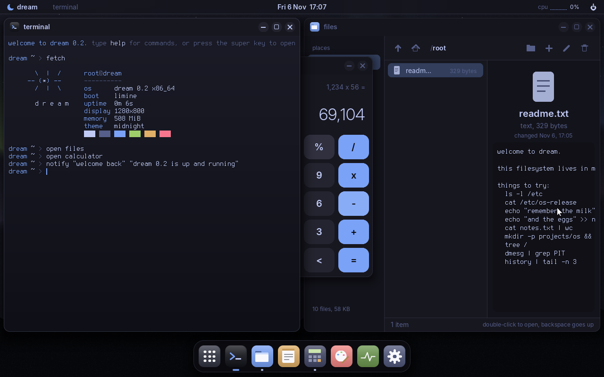
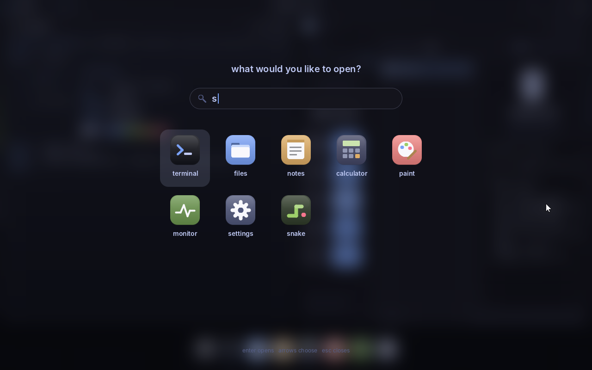
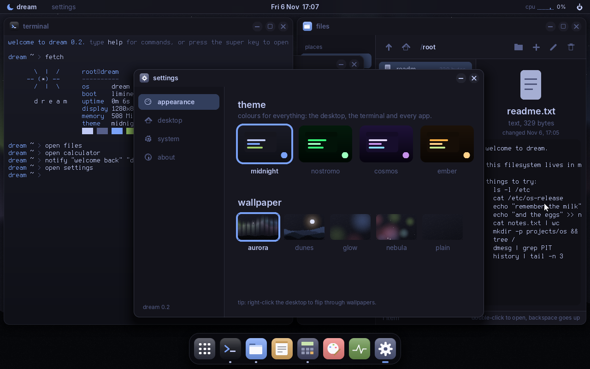
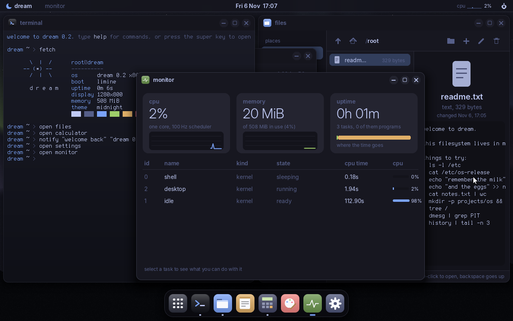
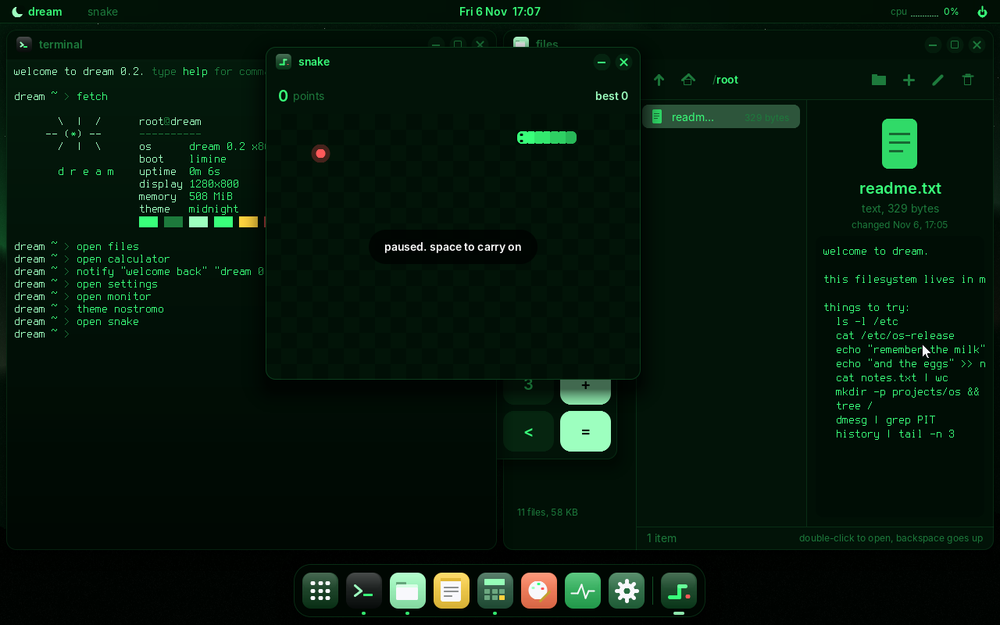

# dream

A small, good-looking x86_64 operating system, written from scratch in C to learn how
computers really work. It boots on real PC firmware (BIOS or UEFI) with
[Limine](https://codeberg.org/Limine/Limine) and runs in QEMU.

It has its own kernel, memory manager, scheduler, user mode, disk driver and filesystem,
plus a modern desktop on top: frosted glass, a dock, a launcher, notifications,
a lock screen, and a handful of apps.



| | |
|---|---|
|  |  |
|  |  |

## Try it

```sh
make run          # build dream.iso and boot it in QEMU (serial log in this terminal)
make run-uefi     # same, with UEFI firmware
make debug        # boot paused, GDB attached, breakpoint on kmain
make wipe-disk    # start over with a blank virtual disk
make install      # adds a `dreamos` command: type it in any terminal to boot dream
```

You need `gcc`, `make`, `xorriso`, `qemu` and `limine`. On Arch Linux:

```sh
sudo pacman -S --needed gcc make limine qemu-desktop libisoburn edk2-ovmf
```

On Debian/Ubuntu, and for more detail, see [docs/BUILDING.md](docs/BUILDING.md).

The mouse just works: dream speaks QEMU's "vmmouse" protocol, so your pointer slides in
and out of the VM window without being captured. (On other emulators it falls back to a
plain PS/2 mouse: click the window to capture it, **Ctrl+Alt+G** to let go.)

## What's in it (v0.2)

**The desktop** ([guide](docs/DESKTOP.md))

- Frosted-glass **top bar**: the moon opens the launcher; then the focused app's name,
  a clock (click it for a calendar), a live CPU graph, and a power menu
  (lock, leave desktop, restart, shut down)
- A **dock** with app icons and running indicators. Clicking an open app raises it,
  or minimizes it if it's already in front
- **Windows** you can minimize, maximize, close and resize, with soft shadows and fades.
  Double-click a title bar to maximize, or drag a window to a screen edge to snap it to half
- A **launcher** (super key): search as you type
- **Notifications**, a right-click **desktop menu**, an **alt+tab** switcher
- A **lock screen** with a big clock and an optional password
- 4 themes (`midnight`, `nostromo`, `cosmos`, `ember`) and 5 wallpapers drawn from maths
  (`aurora`, `dunes`, `glow`, `nebula`, `plain`), all switchable live
- Smooth anti-aliased text, set in [Inter](https://rsms.me/inter/)
- Settings are saved in `/etc/dream.conf`, so they survive a reboot
- One **clipboard** for everything: notes, the terminal (`ctrl+v`, `copy`, `paste`) and programs

**Apps**: terminal (the real shell), files, notes (text editor), calculator, paint,
monitor (CPU/memory graphs and tasks), settings, clock, snake. Every app except the
terminal is an ordinary ring-3 program in `/bin`, drawing through the window system's
system calls, so a bug in an app can't take the system down. (The terminal stays in
the kernel because it *is* the shell's screen.)

**Under the hood**

- **Boot**: Limine, higher-half kernel, own GDT/IDT, remapped PIC, 100 Hz PIT
- **Memory**: bitmap page allocator, `kmalloc`/`kfree`, 4-level page tables
- **Multitasking**: preemptive round-robin scheduler, 10 ms time slices, sleeping, mutexes
- **User mode**: ring-3 programs in their own address spaces, ELF loader, `int 0x80`
  system calls with checked pointers, files, windows and the clipboard from user space,
  background programs (`prog &`), floating point (each task's FPU/SSE registers are
  saved on every switch; try `mandel`). A crashing program gets a "segmentation fault";
  dream carries on
- **Storage**: ATA (IDE) disk driver; *dreamfs* saves the whole file tree to disk after
  every change and restores it at boot
- **Shell** with pipes `|`, redirects `>` `>>`, `;`, `&&`, quotes and history. About
  50 commands: `ls cd cat grep head tail wc tree cp mv rm ps kill free date uname fetch`...
  and desktop ones like `open`, `notify`, `lock`, `theme`, `wallpaper`
- **Drivers**: framebuffer (double buffered), PS/2 keyboard and mouse (with wheel), the VMware/QEMU
  absolute "vmmouse" (no pointer capture in VMs),
  CMOS clock, serial port
- A red **panic screen** with a register dump

## Keyboard shortcuts

| keys | does |
|---|---|
| super or f1 | open the launcher |
| alt + tab | switch windows |
| alt + f4 | close the window |
| f11 | maximize / restore |
| ctrl + alt + t | terminal |
| ctrl + c | stop the running program (terminal) |

## Documentation

- [docs/DESKTOP.md](docs/DESKTOP.md): using the desktop and the apps
- [docs/BUILDING.md](docs/BUILDING.md): building, running, debugging, automated screenshots
- [docs/ARCHITECTURE.md](docs/ARCHITECTURE.md): how it all fits together, from power-on to pixels
- [docs/WRITING-APPS.md](docs/WRITING-APPS.md): add a shell command, a ring-3 program, or a desktop app
- [CHANGELOG.md](CHANGELOG.md): what changed in each version

## Map of the source

```
kernel/main.c            boot sequence, Limine requests, memory map
kernel/arch/             the CPU: gdt, idt + isr.S stubs, pic, pit, port I/O, user.S (into ring 3)
kernel/mm/               pmm (physical pages), heap (kmalloc), vmm (page tables)
kernel/sched/            tasks, the scheduler, the context switch (switch.S)
kernel/proc/process.c    ELF loader, system calls, background programs, stopping crashed programs
include/dream/abi.h      what the kernel and programs agree on: system calls, events, drawing commands
kernel/drivers/          fb, console, theme, keyboard, mouse, ata (disk), rtc, serial
kernel/fs/               ramfs (the file tree in memory), diskfs (saving it to disk)
kernel/shell/            the shell and its commands
kernel/gfx/gfx.c         drawing: surfaces, shapes, smooth lines, bitmap text, damage
kernel/gfx/ui.c          the modern bits: smooth text, see-through shapes, shadows, blur
kernel/gui/wm.c          window manager + compositor + top bar + dock + launcher + lock screen
kernel/gui/uwin.c        windows for ring-3 programs (the kernel side of user/lib/gui.c)
kernel/gui/              terminal, icons, wallpapers, widgets, the app list (which starts the /bin apps)
kernel/apps/edit.c       the text-mode editor (`edit`)
kernel/sys/              config (/etc/dream.conf, passwords), clipboard, CPU usage, syscalls for apps
user/                    ring-3 programs (each .c becomes a program in /bin): the apps (files, notes,
                         calculator, paint, monitor, settings, clock, snake) and small ones (mandel, hi...)
user/lib/                their tiny libc (dream.h) and window library (gui.h)
tools/mkfont.py          turns the Inter font into bitmaps the kernel can draw
tools/qemu_drive.py      drives QEMU headlessly: type, click, take screenshots
```

Suggested reading order: `main.c` → `arch/idt.c` + `arch/isr.S` → `drivers/console.c` →
`shell/shell.c` → `sched/task.c` → `proc/process.c` → `gui/wm.c`.

## Roadmap ideas

- `syscall`/`sysret`; a spawn system call so programs can start programs
- Several terminals
- Read a real filesystem (FAT or ext2), and CDs (ATAPI)
- Sound (PC speaker, AC97) and networking (e1000 or virtio-net)
- ACPI, so `shutdown` works on real hardware too

## Resources

- OSDev wiki: <https://wiki.osdev.org>
- *Operating Systems: Three Easy Pieces*: <https://pages.cs.wisc.edu/~remzi/OSTEP/>
- Limine protocol: <https://codeberg.org/Limine/limine-protocol>
- Intel SDM Vol. 3 (system programming), for when you want the real answers

## Credits

The desktop text is set in **Inter** by Rasmus Andersson and the Inter project authors,
under the SIL Open Font License 1.1 (see `assets/fonts/OFL.txt`). The terminal font is
Terminus. dream is booted by Limine.
