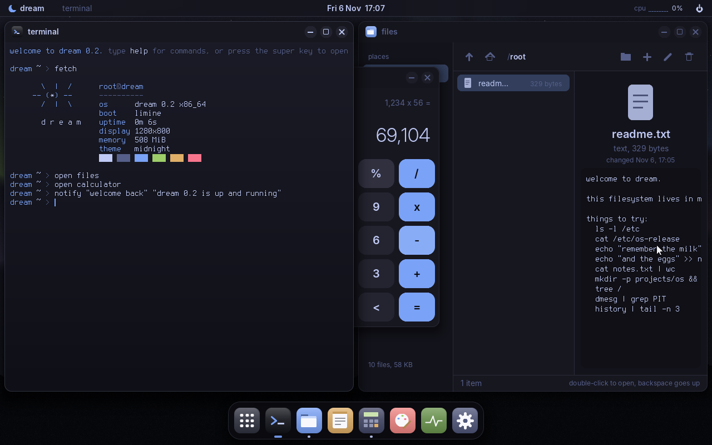
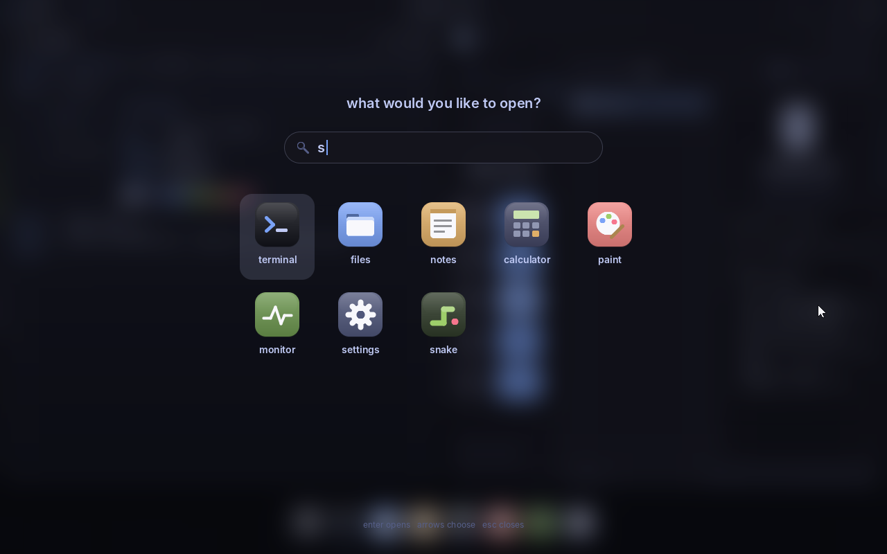
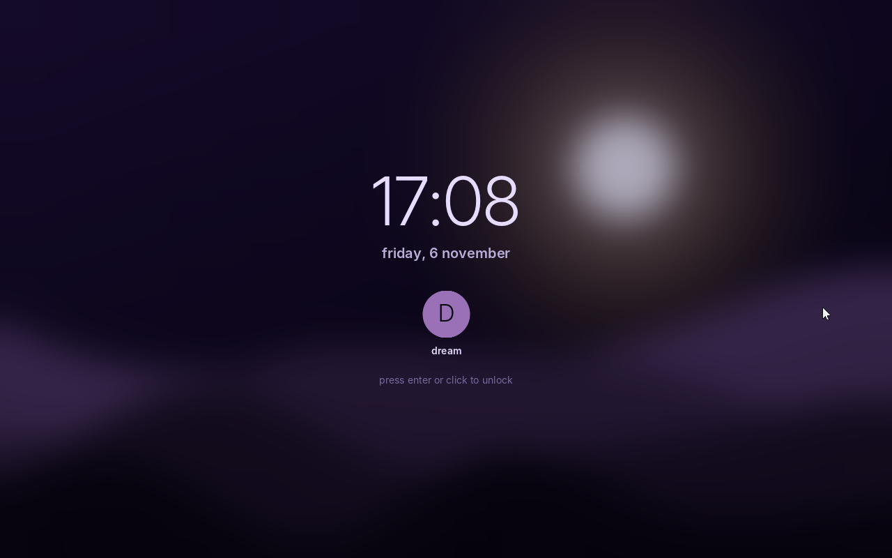
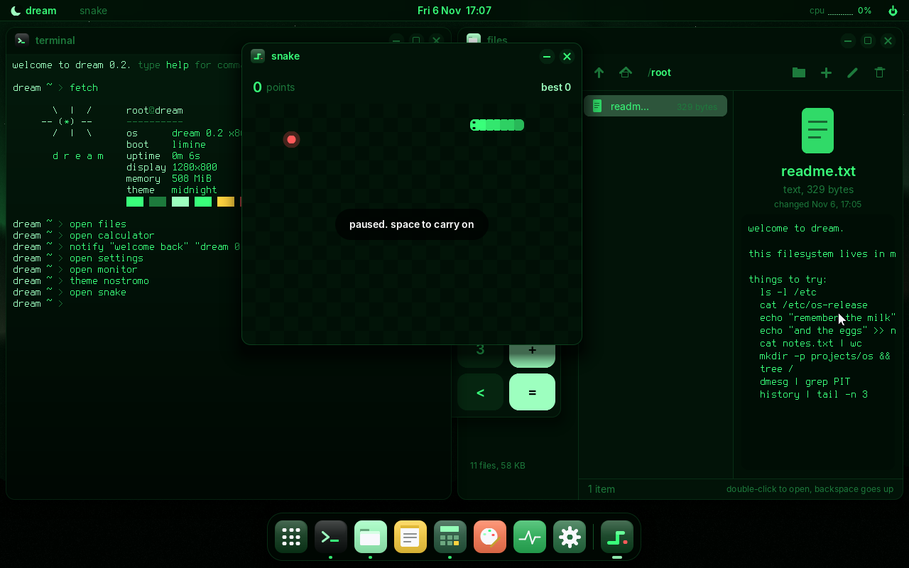

# Using the dream desktop

dream starts the desktop by itself after booting. To get the plain text-mode shell
instead, turn off **settings > desktop > open the desktop when dream starts**, or type
`exit` in the terminal. Type `startx` to come back.



## Mouse and keyboard in the VM

The pointer moves straight into the QEMU window and back out again; nothing needs to be
captured. Keys go to dream while its window is focused.

Your own desktop may keep some shortcuts for itself (on Hyprland/Omarchy the super key,
for example), so they never reach dream. Use the alternatives: **f1** for the launcher,
or the dock and top bar. To send *everything* to dream, press **ctrl+alt+g** in the QEMU
window (it captures keyboard and mouse); press it again to let go.

## The top bar

From left to right:

- **the moon**: opens the launcher (so do the super key and f1)
- the name of the **window you're using**
- the **date and time**. Click it for this month's calendar
- a live **CPU graph** and percentage. Click it to open the monitor
- the **power button**: lock screen, leave desktop (back to text mode), restart, shut down

## The dock

The dock along the bottom holds your apps. A dot under an icon means the app is open
(a wider, coloured bar means it's the one in front). Apps that aren't pinned to the dock,
such as the clock or snake, appear after a divider while they're open.

Click an icon to:

- **open** the app, if it isn't open
- **bring it to the front**, if it's behind something (or minimized)
- **minimize** it, if it's already in front

## Windows

Each window has three buttons on the right of its title bar: **minimize**,
**maximize** (only for windows that can be resized) and **close**.

- **move**: drag the title bar
- **resize**: drag the left, right or bottom edge, or a bottom corner. The pointer turns
  into a double arrow when you're on an edge
- **maximize**: the button, a double-click on the title bar, or **f11**
- **snap**: drag a window against the left or right edge of the screen to fill that half,
  or against the top to maximize it. A blue outline shows where it'll go
- **switch**: **alt + tab** (keep alt down and press tab again to go further back)
- **close**: the × button or **alt + f4**

Closing the terminal only hides it, because the shell keeps running inside it. Get it
back from the dock or with **ctrl + alt + t**.

## The launcher

Press **super** (the Windows key), **f1**, or click the moon. Start typing to narrow the list.
The search looks at app names and descriptions, so "game" finds snake and "edit" finds notes.
**Enter** opens the highlighted app, the **arrow keys** move, **esc** closes.



## Notifications

Cards slide in at the top right and disappear after five seconds. Apps send them
(snake does when you beat your best score), and so can you from the terminal:

```
notify "tea's ready" "it's been four minutes"
```

## The desktop menu

Right-click an empty part of the desktop: open a terminal, start a new note, flip to the
next wallpaper, open settings, or read about dream.

## Locking the screen

Power button > **lock screen**, or type `lock`. Without a password, press enter or click
to come back in. To require one, set it in **settings > system** or with `passwd` in the
terminal. When a password is set and the desktop starts at boot, dream starts locked,
like a login screen.



The password is stored as a salted hash in `/etc/passwd.dream`, not as the password
itself. (The hash is a simple one, fine for learning, not for guarding secrets.)

## The apps

| app | what it does |
|---|---|
| **terminal** | the real dream shell. Every command works here, and the window can be resized |
| **files** | browse folders, with places on the left (home, programs, settings, everything) and a preview on the right. New folder, new file, rename and delete are in the toolbar. Double-click to open: folders open, text files open in notes, programs run in the terminal. Keys: arrows, enter, backspace (up a folder), delete |
| **notes** | a text editor with line numbers and auto-indent. **ctrl+s** saves (it asks where the first time), **ctrl+o** opens a file by path, **ctrl+n** starts a new note. Drag to select; **ctrl+a/c/x/v** select all, copy, cut, paste. It's an ordinary program in `/bin` (try `notes todo.txt &`), so several can be open at once |
| **calculator** | + − × ÷ and percentages with up to six decimal places. Works with the keyboard too: digits, `+ - * /`, enter, backspace, `c` or esc to clear |
| **paint** | draw with the left button, erase with the right. The scroll wheel (or `[` `]`) changes the brush size, **ctrl+z** undoes a stroke, and the window can be resized without losing the picture |
| **monitor** | CPU and memory over the last half minute, uptime, and every task with its share of the CPU. Select a user program and press **end task** to stop it |
| **settings** | appearance (theme, wallpaper), desktop (start at boot, the list of shortcuts), system (computer name, password, storage) and about |
| **clock** | an analog clock |
| **snake** | arrow keys to steer, space to pause, enter to play again. The walls wrap around. Your best score is saved |

## Copy and paste

There's one clipboard for everything:

- **notes**: drag to select, then **ctrl+c** copy, **ctrl+x** cut, **ctrl+v** paste, **ctrl+a** select all
- **terminal**: **ctrl+v** pastes (the first line) at the prompt. To copy, pipe into
  `copy`: `pwd | copy`, `cat todo.txt | copy`, or `copy some words`
- `paste` prints the clipboard, so `paste > file.txt` saves it

Every app except the terminal is an ordinary program in `/bin` (`ls /bin`), so you can
also start one from the terminal: `calculator &`, `files /etc &`, `settings about &`.

## Themes and wallpapers

Pick them in **settings > appearance**, or from the terminal:

```
theme nostromo        # midnight, nostromo, cosmos, ember
wallpaper dunes       # aurora, dunes, glow, nebula, plain
```

Wallpapers are painted with maths when the desktop starts, in the current theme's
colours, so every combination works.



## Opening things from the terminal

```
open files              # any app by name (calc and edit work too)
open notes.txt          # a file opens in notes
files                   # the file browser
```

## Where settings live

Everything you choose is written to `/etc/dream.conf`, a plain text file:

```
theme=nostromo
wallpaper=dunes
autostart=yes
snake_best=230
```

`cat /etc/dream.conf` shows it, and you can edit it with notes or `edit`.
